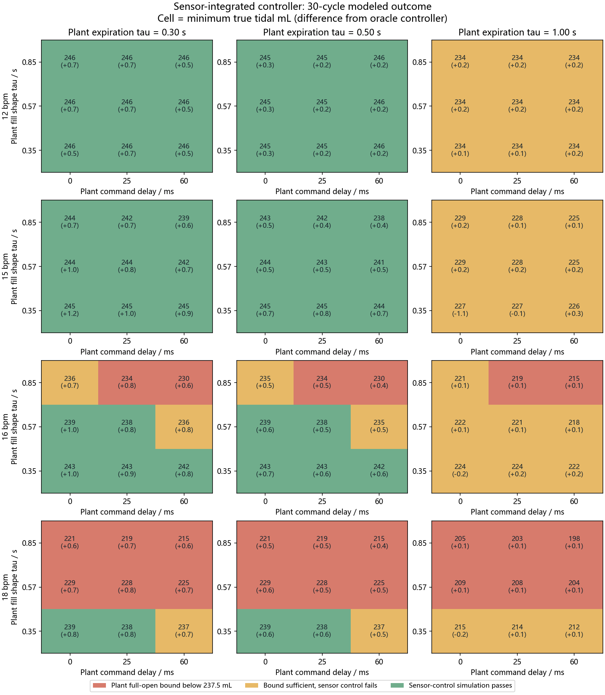

# Sensor-integrated versus true-volume control

All figures are simulated. The 81-case grid uses the same plant assumptions, saved PID/Smith gains and fixed nominal controller model in both runs. The controller information mode changes: sensor mode replaces both true-volume feedback and knowledge of the plant-applied valve command. It calibrates a constant zero offset during the initial 1.50 s precondition, integrates the delayed and noisy signed flow, and gives Smith an input command delayed by the controller's assumed 25 ms. Its feedback does not read the plant's true volume.

| Rate | Oracle simulated passes | Sensor simulated passes | Oracle pass to sensor fail | Sensor pass to oracle fail | Largest end-inspiration volume-estimate error / mL |
| ---: | ---: | ---: | ---: | ---: | ---: |
| 12 bpm | 18/27 | 18/27 | 0 | 0 | 0.4 |
| 15 bpm | 18/27 | 18/27 | 0 | 0 | 7.2 |
| 16 bpm | 8/27 | 10/27 | 0 | 2 | 15.2 |
| 18 bpm | 3/27 | 4/27 | 0 | 1 | 20.3 |

One or more boundary cells change to a numerical pass under sensor feedback. This does not show better sensor control: the estimator and delayed-command assumption change when the valve opens, and a case near 237.5 mL can flip classification with little physical margin.

These case counts are not probabilities. A passing model cell does not imply physical 30-cycle repeatability. Color shows the sensor-controller result; each cell shows its minimum true inspired tidal volume and the change from the oracle controller in parentheses.

## Nominal plant and sensor stress

The following cases keep the plant at tau_in = 0.57 s, tau_out = 0.50 s and direct-path reach time 1.30 s. Fixed bias is an assumed constant SLM offset, and the precondition zero calibration attempts to remove it.

| Sensor case | Rate | True tidal range / mL | Maximum end-inspiration estimate error / mL | Estimated zero bias / SLM | Target check |
| --- | ---: | ---: | ---: | ---: | --- |
| nominal | 12 bpm | 245.5 to 250.0 | 0.1 | -0.016 | PASS |
| nominal | 15 bpm | 243.1 to 246.3 | 2.9 | -0.016 | PASS |
| nominal | 16 bpm | 237.8 to 240.8 | 7.5 | -0.016 | PASS |
| nominal | 18 bpm | 227.7 to 231.1 | 16.8 | -0.016 | FAIL |
| fixed_zero_bias | 12 bpm | 245.5 to 250.0 | 0.1 | +0.234 | PASS |
| fixed_zero_bias | 15 bpm | 243.1 to 246.3 | 2.9 | +0.234 | PASS |
| fixed_zero_bias | 16 bpm | 237.8 to 240.8 | 7.5 | +0.234 | PASS |
| fixed_zero_bias | 18 bpm | 227.7 to 231.1 | 16.8 | +0.234 | FAIL |
| high_sample_noise | 12 bpm | 245.1 to 250.0 | 3.7 | -0.079 | PASS |
| high_sample_noise | 15 bpm | 238.2 to 246.3 | 9.6 | -0.079 | PASS |
| high_sample_noise | 16 bpm | 234.4 to 240.8 | 13.0 | -0.079 | FAIL |
| high_sample_noise | 18 bpm | 225.8 to 231.1 | 20.8 | -0.079 | FAIL |
| long_sensor_lag | 12 bpm | 246.6 to 250.0 | 0.6 | -0.016 | PASS |
| long_sensor_lag | 15 bpm | 244.0 to 246.3 | 10.4 | -0.016 | PASS |
| long_sensor_lag | 16 bpm | 238.6 to 240.8 | 12.2 | -0.016 | PASS |
| long_sensor_lag | 18 bpm | 228.4 to 231.1 | 15.4 | -0.016 | FAIL |

Status transitions across all cases: controlled_fail -> controlled_fail: 34, controlled_fail -> simulated_pass: 3, model_bound_fail -> model_bound_fail: 24, simulated_pass -> simulated_pass: 47.

The estimator assumes the lung begins empty, both valves are closed with zero physical flow during calibration, the sensor offset remains fixed, and standard-flow integral is comparable with the simulated geometric volume. It clips the estimate to the known 250 mL model capacity. None of these assumptions has been validated on the installed path. Pressure sensing, physical PPV actuation and real-time closed-loop control are still absent.
