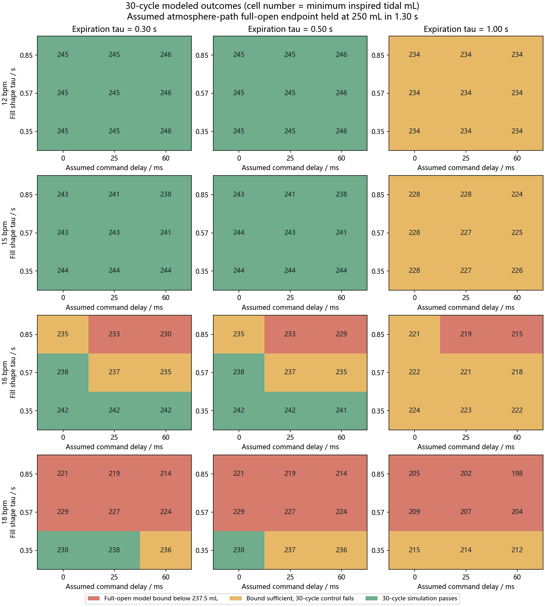
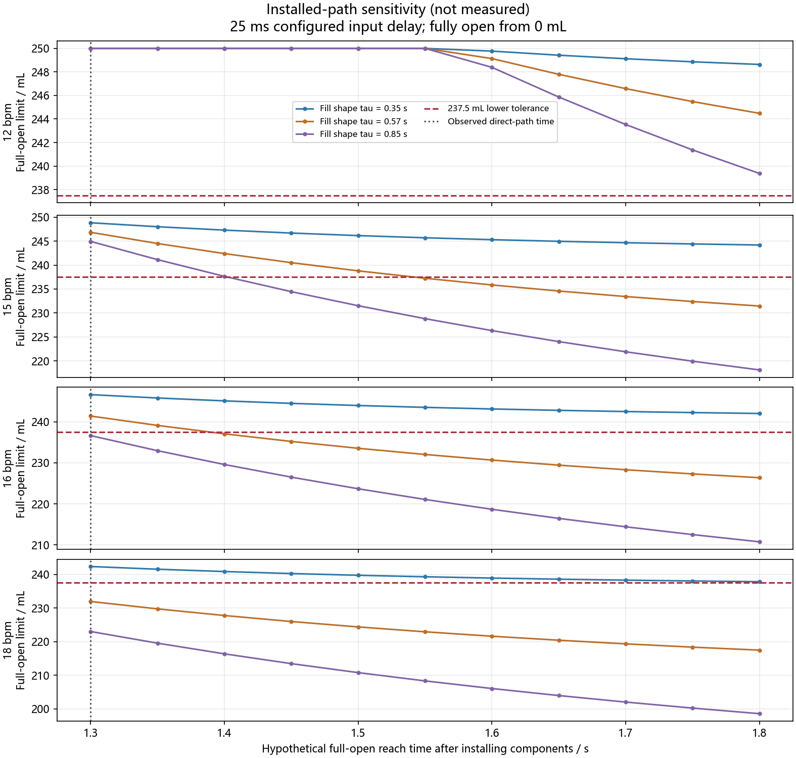

# Single-lung model uncertainty sweep

This is a simulation stress study, not a physical acceptance test. The selected ranges are illustrative assumptions, not measured confidence intervals or scenario probabilities.

The controlled grid fixes the assumed **atmosphere-inspiration** fully open endpoint at 250 mL in 1.30 s. It varies the unmeasured curve shape (tau_in = 0.35/0.57/0.85 s), command delay (0/25/60 ms), and expiration time constant (0.30/0.50/1.00 s). Each cell contains 30 simulated cycles with the saved PID/Smith gains and the optional model-based volume deadline guard. The controller model is fixed at tau_in = 0.57 s, tau_out = 0.50 s and assumed input delay 25 ms while the simulated plant and actual command delay vary. A 25 ms delay is rounded to two 10 ms control samples by the current simulator. A saved manual expiration-flow target is replaced by the phase-derived target to keep all rates comparable; the saved GUI configuration is not changed.

| Rate | Model bound fails | Bound sufficient but control fails | Simulation passes | Minimum tidal across grid / mL | Maximum residual at inspiration start / mL |
| ---: | ---: | ---: | ---: | ---: | ---: |
| 12 bpm | 0 | 9 | 18 | 233.5 | 16.5 |
| 15 bpm | 0 | 9 | 18 | 224.4 | 22.5 |
| 16 bpm | 6 | 13 | 8 | 215.1 | 24.8 |
| 18 bpm | 18 | 6 | 3 | 197.8 | 30.3 |

## 15 and 16 bpm sensitivity

Each row below holds one assumed parameter fixed and varies the other two over their listed values. Each group therefore has nine 30-cycle cases. Counts are scenario counts, not probabilities.

| Rate | Fixed assumption | Value | Pass / 9 | Model bound fail / 9 | Control fail / 9 |
| ---: | --- | ---: | ---: | ---: | ---: |
| 15 bpm | Fill shape tau / s | 0.350 | 6 / 9 | 0 / 9 | 3 / 9 |
| 15 bpm | Fill shape tau / s | 0.570 | 6 / 9 | 0 / 9 | 3 / 9 |
| 15 bpm | Fill shape tau / s | 0.850 | 6 / 9 | 0 / 9 | 3 / 9 |
| 15 bpm | Command delay / s | 0.000 | 6 / 9 | 0 / 9 | 3 / 9 |
| 15 bpm | Command delay / s | 0.025 | 6 / 9 | 0 / 9 | 3 / 9 |
| 15 bpm | Command delay / s | 0.060 | 6 / 9 | 0 / 9 | 3 / 9 |
| 15 bpm | Expiration tau / s | 0.300 | 9 / 9 | 0 / 9 | 0 / 9 |
| 15 bpm | Expiration tau / s | 0.500 | 9 / 9 | 0 / 9 | 0 / 9 |
| 15 bpm | Expiration tau / s | 1.000 | 0 / 9 | 0 / 9 | 9 / 9 |
| 16 bpm | Fill shape tau / s | 0.350 | 6 / 9 | 0 / 9 | 3 / 9 |
| 16 bpm | Fill shape tau / s | 0.570 | 2 / 9 | 0 / 9 | 7 / 9 |
| 16 bpm | Fill shape tau / s | 0.850 | 0 / 9 | 6 / 9 | 3 / 9 |
| 16 bpm | Command delay / s | 0.000 | 4 / 9 | 0 / 9 | 5 / 9 |
| 16 bpm | Command delay / s | 0.025 | 2 / 9 | 3 / 9 | 4 / 9 |
| 16 bpm | Command delay / s | 0.060 | 2 / 9 | 3 / 9 | 4 / 9 |
| 16 bpm | Expiration tau / s | 0.300 | 4 / 9 | 2 / 9 | 3 / 9 |
| 16 bpm | Expiration tau / s | 0.500 | 4 / 9 | 2 / 9 | 3 / 9 |
| 16 bpm | Expiration tau / s | 1.000 | 0 / 9 | 2 / 9 | 7 / 9 |

The 3 passing 18 bpm cells reach only 237.7-238.1 mL at their weakest cycle; mean inspiration valve saturation is 100% or higher. Passing the numerical tolerance here leaves little or no modeled throttling margin.

A model-bound failure means even the fully open model from 0 mL cannot reach the 237.5 mL lower tolerance within the sampled inspiration slot. A control failure with a sufficient bound may involve expiration residual, the chosen PID/reference, or other simulated dynamics; it is not automatically a PID gain problem. Green cells meet the target on every one of 30 cycles and meet the 5% cycle-spread and 1% cadence checks.

## Hypothetical installed path

The 1.30 s endpoint is assumed for the atmosphere path. The final solenoid, PPV, sensor and tubing path has not been measured. The second plot therefore asks what happens if its full-open reach time is 1.30-1.80 s while holding the same candidate curve shapes and a configured 25 ms input delay. These are analytic fully open limits from 0 mL, not controlled runs.

## Current assumed point

| Rate | Minimum/maximum inspired tidal / mL | Full-open bound / mL | Result |
| ---: | ---: | ---: | --- |
| 12 bpm | 245.3 to 250.0 | 250.0 | simulated_pass |
| 15 bpm | 242.6 to 246.3 | 246.8 | simulated_pass |
| 16 bpm | 237.3 to 240.8 | 241.4 | controlled_fail |
| 18 bpm | 227.2 to 231.1 | 231.9 | model_bound_fail |

At 16 bpm, the default case's weakest cycle is 237.3 mL versus the 237.5 mL lower tolerance. This scan uses internal true-volume feedback; a sensor-integrated feedback configuration can cross this narrow boundary differently. Treat 16 bpm as a model-sensitive boundary, not a validated operating point.

The count of passing cells is not a reliability estimate. A different unknown real flow curve could change the result, and the installed path may have a slower reach time than 1.30 s. The controller model is fixed, but its guard and feedforward still read simulator true volume. Physical flow integration, pressure acquisition, valve control and hardware repeatability remain unverified.
